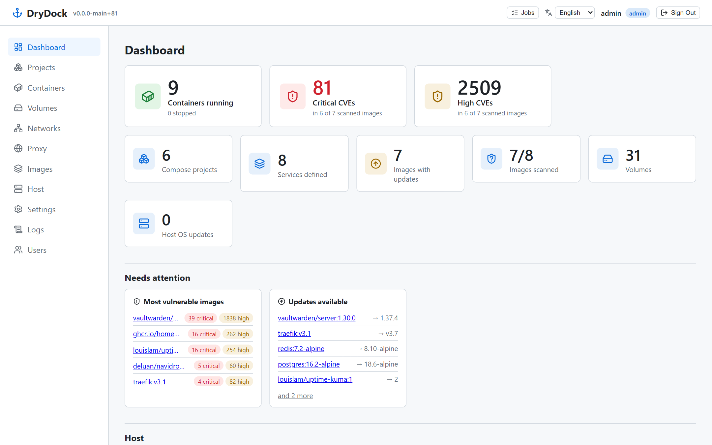
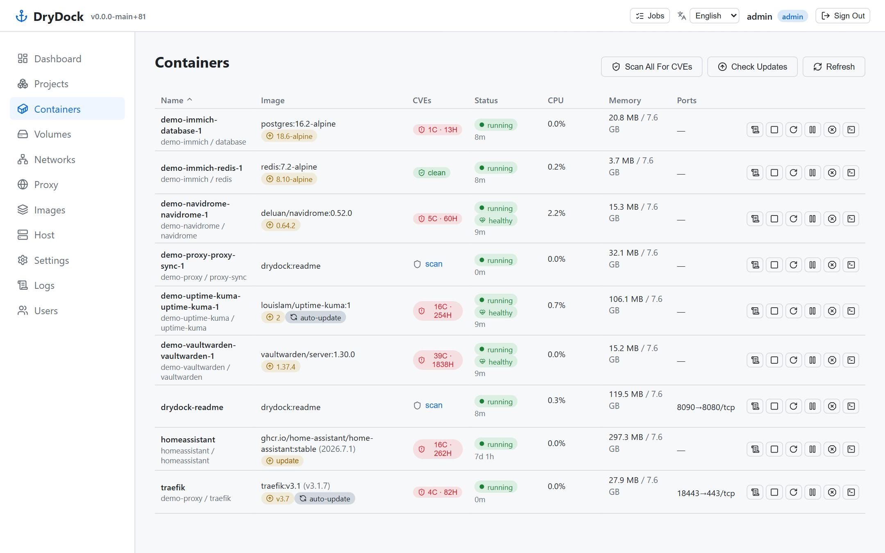
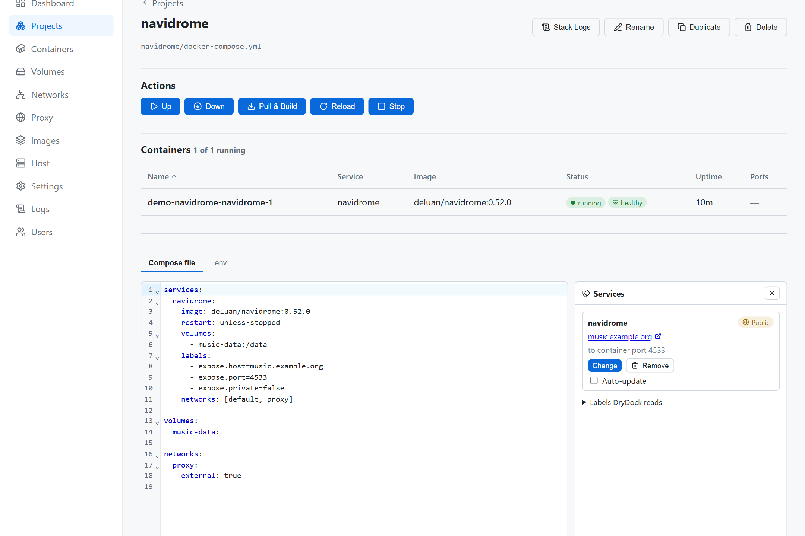
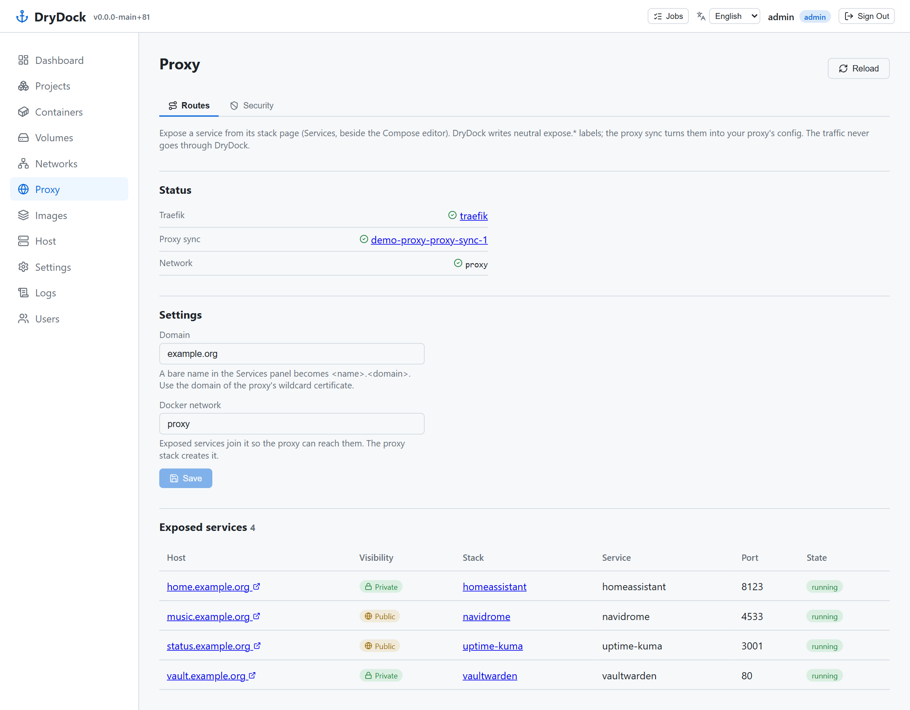

<p align="center">
  
</p>

<h1 align="center">DryDock</h1>

<p align="center">
  <b>Deploy, expose and secure your Docker stacks. One host, one page, security built in.</b><br>
  For your homelab, your NAS, your Raspberry Pi.
</p>

<p align="center">
  <a href="#quick-start">Quick start</a> ·
  <a href="docs/features.md">All features</a> ·
  <a href="docs/reverse-proxy.md">Reverse proxy</a> ·
  <a href="docs/troubleshooting.md">Troubleshooting</a>
</p>



Point DryDock at your folder of Compose files. It runs your stacks, gives them HTTPS host names, and tells you what to fix. Your files stay the source of truth: edit them in DryDock, in your editor or with git.

## Why DryDock

A homelab often needs four tools: Portainer to run containers, a proxy manager for host names, Watchtower for updates and a scanner for CVEs. DryDock does all four from your Compose files. It shows each risk where it lives: CVEs on the image, exposure on the route, bans on the host.

- 📁 **Your files, not a database.** Every Compose file in the folder is a stack. Each edit is validated and backed up before it is written.
- 🌐 **One label, one HTTPS route.** Add `expose.host=music.example.org` and Traefik, SWAG or Caddy serves it, private by default. Switch proxy without touching a stack.
- 🛡️ **Safe by default.** Private routes, HTTPS with HSTS everywhere, no update unless you opt a service in.
- 🔌 **Never in the data path.** The proxy carries traffic, fail2ban bans, Trivy scans. A DryDock restart cuts nothing.
- 🍓 **Light enough for a Pi.** One image, SQLite, `amd64` and `arm64`. No cloud, no agent, no Kubernetes.

## Run

Every stack, container, image, volume and network on the host, with the CVEs and updates beside each one.



- **Stacks:** up, down, pull & build, reload, rename, duplicate, delete. Edit the Compose file and its `.env` in the browser.
- **Containers:** live logs, a shell in the browser, health, restarts, CPU and memory sparklines.
- **Images, volumes, networks:** see what is in use and prune the rest. Browse volume files read-only.
- **Git built in:** commit, push and pull your Compose folder. Build services straight from a git URL.
- **AI assistant:** ask for a change ("add a healthcheck"), review the diff, apply it. OpenAI, Anthropic, GitHub Copilot or a local Ollama.

## Expose

Give a service a host name from its stack page. DryDock writes neutral labels; the proxy does the rest.



- **Pick your proxy:** ready-made stacks for Traefik, SWAG or Caddy, with Let's Encrypt through OVH, Cloudflare, another DNS provider or the HTTP challenge.
- **Wildcard certificates:** your service names stay out of public certificate logs.
- **Private or public:** a private route answers only your LAN, your public IP and the IPs you trust.
- **One map of everything:** the Proxy page shows which host name leads to which stack, service and port, and whether it runs.



## Secure

- **CVE scans:** Trivy scans your images on a schedule and shows what has a fix.
- **Updates:** rebuilt tags, newer versions (`16.2` → newest `16.x` and newest overall), new commits for git builds, and pending OS updates on the host with "reboot required".
- **Opt-in auto-update:** tick a service and DryDock updates it at night, then checks it comes back healthy. Never a new version tag, never a stopped stack.
- **fail2ban on the proxy:** jails for failed logins, scanners and bad bots. Test a rule on your real access log, then apply it.
- **IP blocklist:** known bad IPs (FireHOL level1) dropped by the host's firewall before they reach a container.
- **Access and alerts:** login, admin and user roles, API tokens, and a webhook when something needs you.

## Quick start

```yaml
services:
  drydock:
    image: ghcr.io/o0zz/drydock:latest
    container_name: drydock
    restart: unless-stopped
    ports:
      - "8080:8080"
    volumes:
      - /var/run/docker.sock:/var/run/docker.sock
      - /home/pi/docker:/repo        # your Compose files
      - drydock_data:/data           # database and backups
    environment:
      - TZ=Europe/Paris

volumes:
  drydock_data:
```

1. Run `docker compose up -d`.
2. Open <http://localhost:8080>.
3. Log in with `admin` / `admin`. DryDock asks for a new password first.

> [!WARNING]
> DryDock mounts the Docker socket, which gives it root on the host. Use it only on your LAN, a VPN or Tailscale. Never expose DryDock itself to the internet.

To build from source, replace `image:` with a git URL. Keep the `.git` so the build can read the version:

```yaml
    build:
      context: https://github.com/o0Zz/DryDock.git#main
      args:
        BUILDKIT_CONTEXT_KEEP_GIT_DIR: 1
```

Next: [set up the reverse proxy](docs/reverse-proxy.md) to give your services HTTPS host names.

## Labels

DryDock reads these labels from your Compose files. The **Services** panel beside the Compose editor writes them for you, and the AI assistant knows them too.

| Label | Values | Default | What it does |
| --- | --- | --- | --- |
| `expose.host` | host names, comma-separated | none | The proxy routes `https://<host>` to the service. A service without it is not exposed. |
| `expose.port` | a container port | none | The port the proxy forwards to. |
| `expose.private` | `true`, `false` | `true` | Private: allowed IPs only (`LAN_RANGES`, your public IP, `TRUSTED_IPS`). `false`: anyone. |
| `drydock.update` | `auto` | none | The daily auto-update (Settings) pulls and recreates the service when its tag is rebuilt or its git ref moves. Never a newer tag. |

```yaml
services:
  music:
    image: navidrome/navidrome:latest
    labels:
      - expose.host=music.example.org
      - expose.port=4533
      - expose.private=false
      - drydock.update=auto
    networks: [default, proxy]

networks:
  proxy:
    external: true
```

DryDock reads labels from the running containers, so a change takes effect after **up**. DryDock sets other `drydock.*` labels itself (`drydock.proxy`, `drydock.proxy-sync`, `drydock.job`, `drydock.helper`). Do not add or edit them.

## Configuration

Set these environment variables if you need to. Schedules, notifications and logins are set on the Settings page.

| Variable                     | Default      | Purpose                                        |
| ---------------------------- | ------------ | ---------------------------------------------- |
| `DRYDOCK_REPO_PATH`          | `/repo`      | Folder with your Compose files                 |
| `DRYDOCK_REPO_HOST_PATH`     | *(detected)* | Host path of the repo. Only set it if detection fails (see [Troubleshooting](docs/troubleshooting.md)) |
| `DRYDOCK_DATA_PATH`          | `/data`      | Database, backups and session key              |
| `DRYDOCK_ADMIN_USERNAME`     | `admin`      | First admin, created on first start only       |
| `DRYDOCK_ADMIN_PASSWORD`     | `admin`      | First admin's password. `admin` must be changed at first login. |
| `DRYDOCK_ROOT_PATH`          | *(empty)*    | Set when served under a subpath, e.g. `/drydock` |
| `DRYDOCK_SESSION_HTTPS_ONLY` | `false`      | Set `true` behind an HTTPS proxy               |
| `DRYDOCK_SECRET_KEY`         | *(generated)* | Session signing key, saved in `/data` if not set |
| `DRYDOCK_HELPER_IMAGE`       | `busybox:stable` | Image that reads volume files when DryDock is not in a container (dev) |
| `DRYDOCK_FAIL2BAN_DB`        | `/var/lib/fail2ban/fail2ban.sqlite3` | fail2ban's database on the host |

Behind a reverse proxy, allow WebSocket upgrades so the container shell works. For nginx:

```nginx
proxy_http_version 1.1;
proxy_set_header Upgrade $http_upgrade;
proxy_set_header Connection "upgrade";
```

## Documentation

- [All features](docs/features.md): every page and option, by job.
- [Reverse proxy](docs/reverse-proxy.md): DNS, certificates, private routes, fail2ban.
- [Git](docs/git.md): commit, push and pull your Compose folder.
- [Troubleshooting](docs/troubleshooting.md): common problems, such as memory showing `0B / 0B`.

## Development

You need [uv](https://docs.astral.sh/uv/), Node.js and Docker. In VS Code, the launch config **"Full stack (backend + frontend)"** starts everything.

```powershell
# backend, on port 8080
cd backend
uv sync --extra dev
$env:DRYDOCK_REPO_PATH = "$PWD\..\sample-repo"; $env:DRYDOCK_DATA_PATH = "$PWD\.data"
.venv\Scripts\python.exe -m uvicorn app.main:app --reload --port 8080

# frontend, on http://localhost:5173
cd frontend; npm install; npm run dev
```

CVE scans need [Trivy](https://github.com/aquasecurity/trivy) (`winget install AquaSecurity.Trivy` on Windows). The Docker image already includes it. Tests, migrations and conventions are in [CLAUDE.md](CLAUDE.md).

## Not done yet

- Browsing and restoring Compose file backups from the UI.
- Translated server messages: API errors and job output stay in English.
